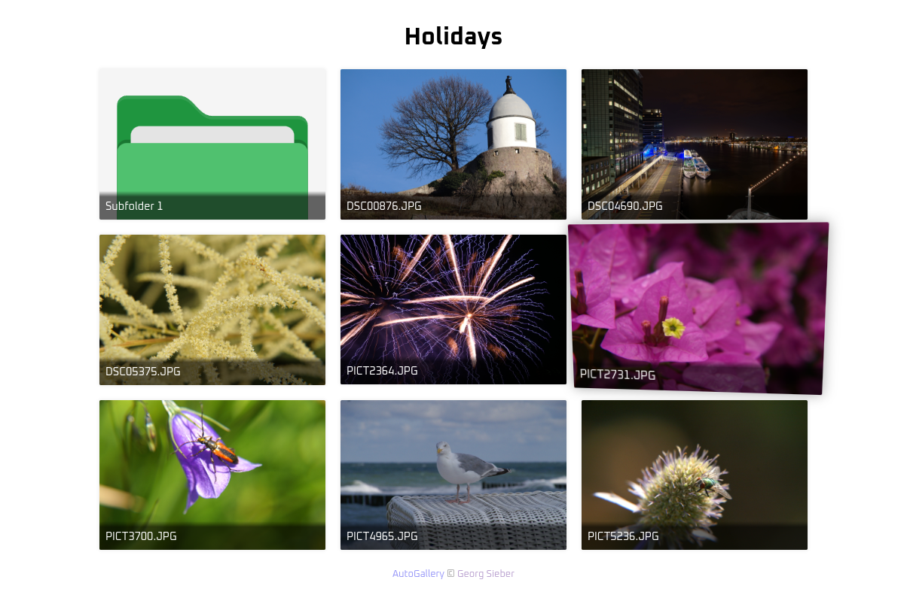
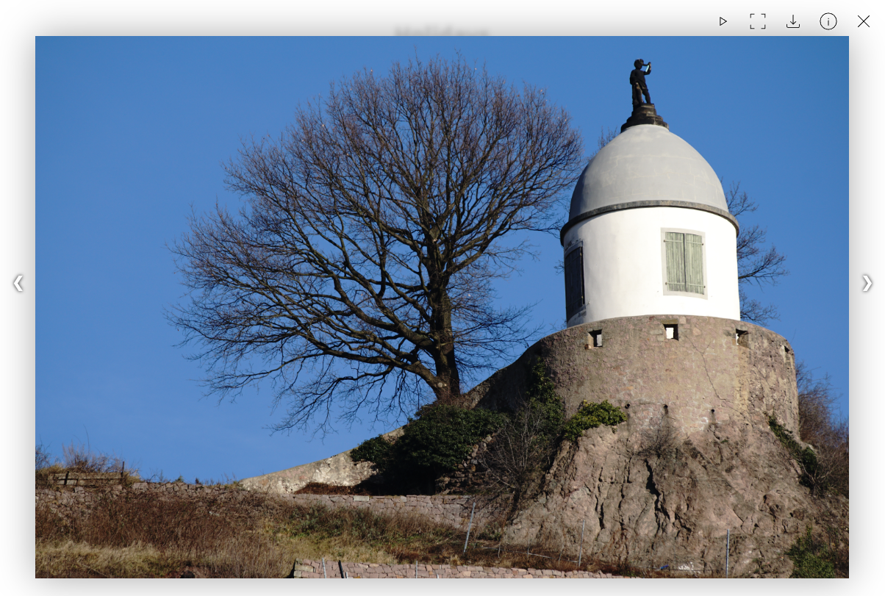

# AutoGallery
AutoGallery is a simple PHP web app for presenting images, videos and other files with some special features.

## Features
- images
  - optional display of IPTC fields
  - lightbox with slideshow, fullscreen & download option
- videos
  - display chapters and subtitles
- nice 3D effect on mouse hover
- optional password protection
- dark mode




## Installation
1. Copy all files onto your web server.
2. Copy your files (images, videos and other files; sub-directories possible) into the `media` dir.
3. Create `conf.php` from `conf.php.example`.  
   Optional: change values:
   - change gallery title in `const TITLE`
   - set a password in `const PASSWORD` (can also be an array with multiple passwords)
   - set which IPTC fields should be shown in `const PHOTO_TITLE` and `const PHOTO_SUBTITLE`

## Usage
### ZIP Downloads
The first ZIP download saves `.download.zip` in the current media folder. Later downloads reuse it until files are added, removed, renamed, or their size or modification time changes. The hidden archive is excluded from gallery listings and ZIP contents. The media folder must be writable to retain the cache, otherwise downloads use a temporary archive.

### Symlinks
The application supports symlinks which allows you to create easy-to-read URLs. Example: you have a folder called "Holidays June 2014". You can create a symlink via `ln -s "Holidays June 2014" "holidays2014"` so you can share the simpler URL `https://gallery.example.com/holidays2014` with your friends. The web app still shows the nice name "Holidays June 2014" as headline even when accessed via shortlink.

### HTML Description
You can display a descriptive text to each folder by creating a file `index.html` in your media folder with the desired HTML content.

### Hide Folders
You can hide folders the common Unix way by adding a "." at the beginning of the folder name. The folder is still accessible!

### Image Thumbnails
Enable `IMAGE_THUMBNAILS` in `conf.php` to generate cached JPEG previews when a gallery folder is first opened. Set `IMAGE_THUMBNAIL_QUALITY` (0-100, default `80`) and `IMAGE_THUMBNAIL_MAX_RESOLUTION` (longest edge in pixels, default `1920`). Aspect ratio is preserved and smaller images are not enlarged.

Requires PHP GD and write permission for the web server in each media folder. Thumbnails are stored in that folder's hidden `.thumbs` directory and served through the authenticated `media.php` endpoint. The gallery uses previews; the lightbox and individual and ZIP downloads use the originals. JPEG, PNG and static WebP are supported.

With `ffmpeg` and `ffprobe` installed, the same setting also creates video posters from a frame one-third of the way through the video, using the same JPEG quality and maximum resolution. Custom video thumbnails take precedence.

The first visit may take longer while previews are generated, subsequent visits reuse them. You can delete `.thumbs` directories to clear old entries and they will be recreated as needed.

### Videos with Chapters, Subtitles and Thumbnail
Video subtitles and chapters are read by Browsers from .vtt files. If you want to add such to a video, you need to place a .vtt file using the following file name schema inside the `.thumbs` dir:
- Subtitles: `<FILENAME>.subtitles.<LANGCODE>.vtt`, e.g. `myvideo.subtitles.de.vtt`
- Chapters: `<FILENAME>.chapters.<LANGCODE>.vtt`, e.g. `myvideo.chapters.en.vtt`

- `<FILENAME>`: name of the corresponding video file (without file extension)
- `<LANGCODE>`: 2-char language code

A file tree could look like this:
```
media/
- myvideo.mp4
- .thumbs/
-- myvideo.subtitles.en.vtt
-- myvideo.subtitles.de.vtt
-- myvideo.chapters.en.vtt
-- myvideo.mp4.jpg
```

If available, embedded chapters from video files can be extracted automatically using `ffprobe`. Make sure ffmpeg is installed and then set `VIDEO_EXTRACT_METADATA = true` in the config file.

### Statistics
If you want to capture visitor statistics, you can connect with a Matomo installation. For this, enter your Matomo credentials in the `MATOMO_*` constants in `conf.php`.
